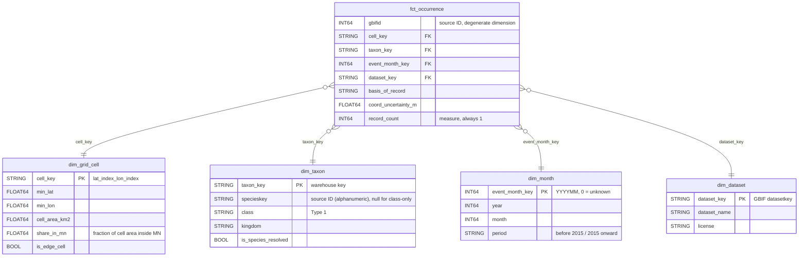

# P1 Plan — Minnesota Wildlife Survey Gap Finder

> Checks are in [`sql/01_source_profile.sql`](../sql/01_source_profile.sql). P0 evidence: [`p0-feasibility-results.md`](../p0-feasibility-results.md).
> P1 checks ran on 2026-10-26 against the current working table, which is a **~8.4% block sample** (see the note under the grain test).

## 1. Establish the question and check the source

### Question

| Item | Carried forward / decided |
|---|---|
| Audience | Survey coordinators in a state nongame wildlife program who plan each season's field surveys with a small staff and volunteer pool |
| Need | Decide where and when to send limited field-survey days |
| **Primary question** | For a chosen animal class (birds, amphibians, reptiles) and period, which 0.25° grid cells in Minnesota have few or no occurrence records? |
| Supporting question | In which months is each class most often recorded? (Same fact, grouped by month instead of cell.) |
| Claim limit | Results describe **recording density** and flag **possible survey gaps**. They do not measure abundance or establish that a survey is needed. |

**Material change from P0.** P0 proposed four questions (Q-A to Q-D). P1 keeps Q-A as the primary question and Q-D as the supporting question. Q-B (trends) and Q-C (lapsed areas) are dropped for now: eBird supplies 88% of records, so year-over-year change mostly reflects observer effort, and the instructor asked to keep claims to recording density and possible gaps.

### Focused source profile

| Item | Value |
|---|---|
| Source object (public) | `bigquery-public-data.gbif.occurrences` (US multi-region; 3,729,438,201 rows, 1.83 TB; snapshot last modified 2026-10-02) |
| Source object (working) | `fiery-monitor-508317-a8.p0_scratch.mn_occurrences` — bounded Minnesota extract (11 columns, clipped to the state boundary). The P0 evidence came from the full extract; the table now holds a 10% block-sample rebuild (Step 2-ALT) made later on 2026-10-14 |
| One source row | One occurrence record: a taxon observed or collected at a place and time, as published by one dataset |
| Size and coverage | Full extract (P0): 20,852,477 rows; years 1800–2026; 85% of records since 2015. Current sampled table: 1,749,325 rows |
| Candidate identifiers | `gbifid` (record), `specieskey` (species), `datasetkey` (publisher dataset) |
| Data issue that affects the question | Cells with **zero** records do not appear in the source at all — yet zero-record cells are the strongest "possible gap" answer. The model must supply them (see Task 2). Also: 1.94% of records lack a `specieskey` and 0.20% lack a `class`. |

### Grain test

**Proposed fact grain:** one row per GBIF occurrence record, identified by `gbifid`.

| Check (`01_source_profile.sql`) | Expected | Observed (sampled table) |
|---|---|---|
| 1. Source rows | 20,852,477 (full extract, P0 Q3) | 1,749,325 (~8.4% sample) |
| 1. Rows with null `gbifid` | 0 | 0 |
| 1. Repeated `gbifid` groups | 0 | 0 |
| 2. Null `specieskey` | ~1.94% (P0) | 7,386 (0.42%) |
| 2. Null `class` | ~0.20% (P0) | 1,720 (0.10%) |
| 2. Class known, species unknown | — | 5,670 |
| 2. Null `year` / null `month` | ~0.12% / ~1.43% (P0) | 3,158 (0.18%) / 18,547 (1.06%) |
| 3. `specieskey` values mapping to more than one class | 0 | 0 of 7,955 species keys |
| 4. Cells with records, 2015 onward (Aves / Amphibia / Reptilia) | — | 459 / 219 / 182 |

**Sampling note.** The table-metadata check (`p0_scratch.__TABLES__`) shows both working tables were recreated on 2026-10-14 at 23:43 UTC, after the full extract used for P0: `mn_box_occurrences` holds 2,614,310 rows (8.6% of P0's 30,232,036) and `mn_occurrences` 1,749,325 (8.4% of 20,852,477), consistent with the Step 2-ALT `TABLESAMPLE SYSTEM (10 PERCENT)` query. Block sampling keeps whole storage blocks, so null rates differ from the full extract (for example, null `specieskey` 0.42% here versus 1.94% in P0). The grain and key-mapping results are structural and do not depend on sampling, but **cell counts do**: a sample makes cells look emptier than they are, which would inflate "possible gaps". The model must therefore be built on the full extract (first P2 step).

**Conclusion.** `gbifid` is complete and unique in both the full extract (P0) and the current sample, so it supports a one-row-per-occurrence fact, and every species key maps to exactly one class, so the taxon dimension can be keyed by species. Uniqueness does not make every row useful: rows with a missing species, class, year or month stay in the fact but map to "unknown" dimension members (Task 2), so totals reconcile and the gaps are visible rather than silently dropped.

### Evidence that shaped the model

| Check | Finding | Decision it settled |
|---|---|---|
| 3 | 0 of 7,955 species keys map to more than one class | `dim_taxon` can be keyed by species with class as an attribute; the current snapshot is internally consistent, so a Type 1 taxonomy has one unambiguous class per species |
| 2 | 5,670 rows have a class but no species key | Without a class-only taxon member these rows would drop out of class counts; the model adds one per class |
| 4 | Since 2015, amphibians have records in 219 cells and reptiles in 182, versus 459 for birds | Many in-state cells have no records for the target classes and so never appear in the fact; this is why the model needs a complete cell spine |
| 5 | The working table is a ~8.4% block sample | Cell counts from a sample overstate gaps; the serving layer must be built from the full extract |
| 6 | 482 cells of 0.25° intersect Minnesota; 125 (26%) are edge cells and 60 are mostly outside the state | The spine has 482 rows per class and period; a quarter of the map is edge cells, so edge handling is not a corner case |
| 7 | Amphibians, 2015 onward (sample): 263 of 482 cells have no records; 442 (92%) fall under the provisional "< 5 records" rule; 118 of those 442 (26.7%) are edge cells, including 58 of the 60 cells mostly outside Minnesota | **Two revisions.** (a) The rule set in advance (area-adjust if edge cells exceed a quarter of gap cells) is triggered, so the gap flag uses records per km² of in-state area. (b) A fixed count that flags 92% of the state gives a coordinator no ranking, so the fixed threshold is replaced by a relative rule (Task 2) |
| 8 | Reclassifying the most-recorded amphibian species (key `66LTT`, 343 sample records) turns 11 more cells into gaps from 2015 onward (442 → 453) and 2 more before 2015 (478 → 480) | Measures the history consequence used to choose Type 1 over Type 2 (Task 2); the 442 gap cells match check 7, so the two checks agree |
| 9 | Planned for P2 (query saved as check 9): count `specieskey` values in the legacy integer format vs the new alphanumeric format on the full extract | If any legacy keys appear, P2 adds a mapping step to the new keys before building `dim_taxon`, so one species cannot be counted under two keys |

## 2. Define the model and predict a history consequence

### Process, fact type, and grain

| Item | Decision |
|---|---|
| Business process | Recording of wildlife occurrences in Minnesota, as aggregated by GBIF |
| Fact table | `fct_occurrence` — transaction fact |
| Grain | **One row represents one GBIF occurrence record located in Minnesota.** |
| Measure | `record_count` (= 1 per row; additive across every dimension) |

**Consequential choice: a complete grid-cell spine.** The primary answer depends on cells with *no* records, which never appear in the fact. `dim_grid_cell` will therefore be generated from the Minnesota boundary: every 0.25° cell that intersects the state, not only cells that have records. Serving tables start from this spine and left-join counts, filling zeros. The tradeoff is an extra build step and the need to handle edge cells that are only partly inside Minnesota (Risk 2), but without it the product cannot show the gaps it exists to find.

### Diagram

**Key strategy.** `gbifid` stays in the fact as the source identifier. `cell_key` is a deterministic warehouse key computed from coordinates (`FLOOR(lat/0.25)_FLOOR(lon/0.25)`), so it is reproducible across rebuilds. `taxon_key` is a warehouse key, not `specieskey`, because records without a species still need a class: those map to one "class-only" member per class (for example, `CLASS:Amphibia`), and records with neither species nor class map to `UNKNOWN`. `event_month_key` uses `0` for a missing year or month.

**Tracing the primary question.** For amphibians, 2015 onward:
`dim_grid_cell` (all Minnesota cells) ← left join `fct_occurrence` filtered by `dim_taxon.class = 'Amphibia'` and `dim_month.period = '2015 onward'` → `SUM(record_count)` per `cell_key` (0 where nothing joins) → cells under the "few records" threshold are flagged as possible gaps.
**Gap rule (revised by checks 6–7).** A fixed rule of "fewer than 5 records" flagged 92% of cells, which gives a coordinator no way to rank them, and a quarter of flagged cells were edge cells that cover less of the state. The rule is therefore: compute records per 100 km² of **in-state** area (`record_count / (cell_area_km2 × share_in_mn) × 100`); a cell is a possible gap for a class and period if it has **no records** or its density is in the **lowest quartile of cells that have records**. Thresholds are recalibrated on the full extract in P2, because sampling alone makes cells look emptier.
The supporting question uses the same fact, `dim_taxon.class` as a filter and `dim_month.month` as the grouping.

### History decision

| Item | Decision |
|---|---|
| Changing attribute | `dim_taxon.class` (and species membership). GBIF revises its taxonomic backbone, so a species can move to another class or two species keys can be merged. P0 already showed this kind of naming difference: reptiles are filed as `Reptilia`, not `Squamata`/`Testudines`. |
| Treatment | **Type 1** — overwrite with the current backbone. Coordinators plan against today's taxonomy, so every period should be counted under current classes. |
| Source ID vs warehouse key | `specieskey` is the source ID (an alphanumeric Catalogue of Life–based key since GBIF's mid-2026 switch); `taxon_key` is the warehouse key. Under Type 1 there is one row per species, so the two stay aligned; when a backbone release merges or re-keys a species, the old source key is repointed to the surviving member. |
| Date roles | Two dates must not be confused: the **event month** (when the animal was recorded; drives every result) and the **snapshot date** (when GBIF published the copy, 2026-10-02; recorded as load metadata only). `dim_month` is shared by both serving tables, so the cell table and the seasonality table use the same period definition. |
| Predicted effect on the primary question | When a species changes class, its records move to the new class **in every period**, including past ones. A cell's amphibian count for "before 2015" can change after a backbone update even though no new records arrived, so a cell can switch between "possible gap" and "not a gap" retroactively. Total records across all classes do not change. |
| Testable by P3 | Bounded change case: in a copy of `dim_taxon`, reassign one amphibian species to `Reptilia`, rebuild the serving table, and show (a) amphibian counts drop and reptile counts rise by exactly that species' records in **both** periods, and (b) the all-class total is unchanged. |

**Why Type 1 rather than Type 2.** Example: one species with 40 records before 2015 and 60 since is reclassified from Amphibia to Reptilia in a backbone update.

| | Type 1 (chosen) | Type 2 (keep class as of each record's load) |
|---|---|---|
| Amphibian count, before 2015 | Falls by 40 | Unchanged |
| Amphibian count, 2015 onward | Falls by 60 | Falls only for records loaded after the update |
| What a coordinator sees | Both periods use today's classes, so a cell's "before" and "after" counts are comparable | The same species is an amphibian in some years and a reptile in others, so a cell can look like it gained or lost amphibian records purely from reclassification |

**Measured on project data (check 8).** If the most-recorded amphibian species (taxon key `66LTT`, 343 records in the sample) were reclassified, Type 1 would turn 11 more cells into possible gaps from 2015 onward (442 → 453) and 2 more before 2015 (478 → 480). Type 2 would leave the before-2015 map at 478. One reclassification therefore changes about 2% of the current map, enough for a coordinator to see different priority cells. The before-2015 map barely moves because, in the sample, it is already almost entirely gaps (478 of 482); this is rechecked on the full extract.

**The source's identifiers have already changed once.** The key `66LTT` is not a legacy GBIF integer key. GBIF made the Catalogue of Life Extended Release its default taxonomy in mid-2026, replacing integer species keys (for example `1427067`) with alphanumeric ones (`Q2M4` for the same species); legacy keys redirect through a mapping file ([GBIF data blog](https://data-blog.gbif.org/post/catalogue-of-life-taxonomic-backbone/)). My snapshot (2026-10-02) uses the new scheme. This confirms the plan's separation of source and warehouse keys: `taxon_key` must not assume a source key is permanent, and a future backbone release can change both keys and classes. Check 9, run on the full extract in P2, will confirm whether the snapshot uses one key scheme throughout.

The primary question compares cells across periods for one class, so the class must mean the same thing in every period; Type 2 would mix taxonomies within a single map. Check 3 shows each species key has exactly one class in the current snapshot, so Type 1 gives one consistent answer. Type 2 would only be worth its cost if the audience needed to reproduce a past report exactly, which this audience does not.

`dim_dataset` (name, license) is treated as fixed as of the 2026-10-02 snapshot.

## 3. Plan the build and its checks

### Layers

| Layer | Planned object(s) | What it does |
|---|---|---|
| Raw | `raw.gbif_mn_occurrences` | Full (unsampled) Minnesota extract, rebuilt once with the P0 Step 2b box query and 2c boundary clip, plus a load-date column |
| Raw | `raw.mn_boundary` | Minnesota polygon from `bigquery-public-data.geo_us_boundaries.states` |
| Curated | `cur.dim_grid_cell` | All 482 0.25° cells intersecting Minnesota, with `cell_area_km2`, `share_in_mn` and `is_edge_cell` |
| Curated | `cur.dim_taxon`, `cur.dim_month`, `cur.dim_dataset` | Dimensions with unknown / class-only members |
| Curated | `cur.fct_occurrence` | One row per `gbifid`, keys resolved, excludes records known to exceed 10 km uncertainty (0.55%) |
| Serving | `srv.cell_class_period_density` | Full cell spine × target class × period: `record_count`, `distinct_species` (not additive across cells or periods), `possible_gap` flag |
| Serving | `srv.class_month_seasonality` | Records by class and month for the supporting question |

**Preliminary run order:** `raw.mn_boundary` → `raw.gbif_mn_occurrences` → `cur.dim_grid_cell` → `cur.dim_taxon` → `cur.dim_month` → `cur.dim_dataset` → `cur.fct_occurrence` → `srv.cell_class_period_density` → `srv.class_month_seasonality`.

### Source-to-target mapping

| Source column (`raw.gbif_mn_occurrences`) | Target | Transformation |
|---|---|---|
| `gbifid` | `fct_occurrence.gbifid` | None; grain key |
| `decimallatitude`, `decimallongitude` | `fct_occurrence.cell_key` | `FLOOR(lat/0.25) || '_' || FLOOR(lon/0.25)`; coordinates not carried forward |
| `specieskey`, `class`, `kingdom` | `dim_taxon` / `fct_occurrence.taxon_key` | `specieskey` (already a string key); if null, `'CLASS:' || class`; if both null, `'UNKNOWN'` |
| `year`, `month` | `dim_month` / `fct_occurrence.event_month_key` | `year*100 + month`; `0` if either is null; `period` from year |
| `datasetkey` | `dim_dataset` / `fct_occurrence.dataset_key` | None; name and license added from GBIF dataset metadata for the top datasets |
| `basisofrecord` | `fct_occurrence.basis_of_record` | None |
| `coordinateuncertaintyinmeters` | `fct_occurrence.coord_uncertainty_m` | Rows > 10,000 m excluded and counted |
| (constant) | `fct_occurrence.record_count` | `1` |
| `state_geom` (`raw.mn_boundary`) | `dim_grid_cell` | Generate every 0.25° cell intersecting the polygon; `share_in_mn = ST_AREA(ST_INTERSECTION(cell, state)) / ST_AREA(cell)` |

### Field path

| Step | Field |
|---|---|
| Source | `decimallatitude`, `decimallongitude` (point coordinates) |
| Raw | Same values, copied unchanged |
| Curated | Converted to `cell_key = FLOOR(lat/0.25) || '_' || FLOOR(lon/0.25)` in `fct_occurrence`; the raw coordinates are not carried forward |
| Serving | `record_count` summed per `cell_key`, starting from the full `dim_grid_cell` spine, so empty cells show 0 |
| Audience output | Grid map: each cell shaded by recording density, with low-record cells marked "possible survey gap" for the chosen class and period |

### Risks and planned checks

| # | Risk | Planned check | Expected result | Where |
|---|---|---|---|---|
| 1 (grain / relationships) | Fact rows fail to join a dimension (null species, class or month; a coordinate outside the cell spine) and silently drop out of counts | Count fact rows with no match in each dimension; reconcile `SUM(record_count)` in the serving table (all classes, all periods) with the curated fact row count, and the fact count with raw rows minus the documented >10 km exclusion | 0 unmatched rows per dimension; serving total = fact rows = raw rows − excluded rows | After `cur.fct_occurrence` and after `srv.cell_class_period_density` |
| 2 (meaning of the audience result) | Edge cells that are only partly inside Minnesota have fewer records because they cover less of the state, so they would be falsely flagged as "possible gaps" | Compute `share_in_mn` for every cell; count cells flagged `possible_gap` that are edge cells; compare gap flags with and without an area adjustment | 125 edge cells identified (check 6); after area adjustment, the share of gap cells that are edge cells should fall below the unadjusted 26.7% (check 7) | In `cur.dim_grid_cell` and `srv.cell_class_period_density` |
| 3 (source constraint) | 94% of records have no coordinate-uncertainty value, so imprecise points may land in the wrong cell | Report the share of fact rows with null, ≤10 km and >10 km uncertainty; keep 0.25° cells (~28 km) | Null share ≈ 94%, >10 km ≈ 0.55% (matches P0) | `cur.fct_occurrence` |

### Access

The traced field (point coordinates) is **public but sensitive for some species**: GBIF publishers may generalize or withhold locations of at-risk species, and precise points could help locate them. Decision: **exclude** precise coordinates from the Serving layer and audience output. Coordinates stay only in Raw and Curated, which are accessed by the project owner and steward (me, Stephen). The intended users, survey coordinators, see only the Serving layer and dashboard, which show 0.25° cell counts. They should not reappear in the audience output; a cell-level count does not reveal a point location.

### Limitation and next step

**Largest remaining limitation:** there is no measure of survey effort, so the product cannot separate "few animals" from "few observers". A low count is a possible gap, not a confirmed one, and eBird dominance means bird density mostly reflects birding activity.

**First P2 build step:** rebuild the **full** Minnesota extract into `raw.gbif_mn_occurrences` with the P0 Step 2b query (about 453 GB scanned, so run it when the monthly free allowance has room, e.g. after the 1 November reset), confirm 20.85M rows and rerun check 1, then build `cur.dim_grid_cell` from the Minnesota boundary.

## 4. Diagnose and revise the plan

### Change memo

| Item | Response |
|---|---|
| Feedback that changed the plan | No peer-diagnosis feedback was received on this draft. The plan was revised from two other sources. (1) **Instructor feedback on P0:** keep claims to recording density and possible survey gaps; this is the claim limit in Task 1, and the trend and lapsed-area questions were dropped. (2) **My own checks:** check 5 found the working table is a ~8.4% sample, so the first P2 step is now a full rebuild; checks 6–7 showed the fixed "fewer than 5 records" rule flagged 92% of cells and that 26.7% of flagged cells were edge cells, so the gap rule became area-adjusted density with a relative threshold; check 8 measured the Type 1 vs Type 2 difference (11 cells since 2015). |
| Feedback not adopted, and why | None: no external feedback was declined. One option I considered and did not adopt was keeping the fixed record-count threshold, because on my data it could not rank cells for a coordinator. |
| Main remaining uncertainty | Where the relative gap threshold lands on the full extract: the checks so far ran on an ~8.4% sample, so the cell counts behind the gap rule must be recomputed after the full rebuild, which also depends on the free scan allowance having room. |

### AI and tool use

| What | How it was verified |
|---|---|
| Claude (Anthropic) drafted the structure and wording of this plan, the model diagram, and the queries in `sql/01_source_profile.sql`, working from my P0 files, my query results, and the P1 instructions and rubric. | I ran every query (checks 1–8) in BigQuery myself and recorded the results shown. I compared them with my P0 evidence, which is how the sampled working table was found (1,749,325 rows against 20,852,477 in P0) and confirmed with the table-metadata check. The diagram was rendered to confirm it displays correctly. The background on GBIF's mid-2026 switch to Catalogue of Life keys comes from GBIF's own data blog. The decisions (grain, cell spine, revised gap rule, Type 1 taxonomy) are mine to defend, and I can explain each one. |
